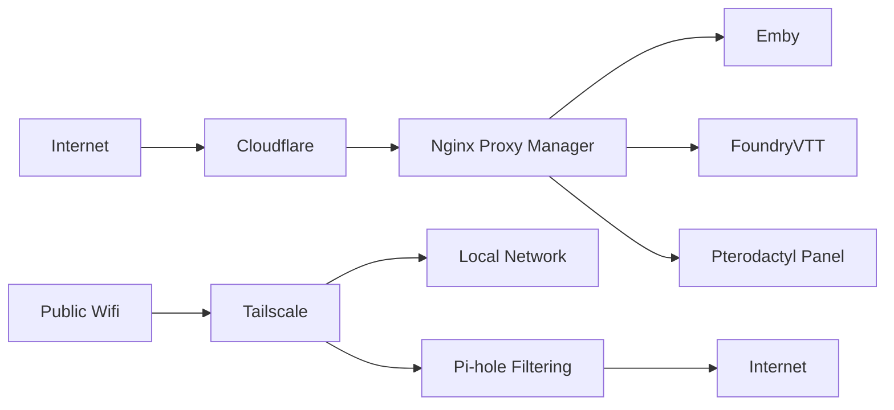

# Network Architecture

## Purpose

This document describes the logical network architecture of the homelab, including traffic flow, network services, public ingress, remote access, and planned network segmentation.

The network is designed to:

- Support self-hosted applications and services.
- Centralize public ingress through a reverse proxy.
- Provide secure remote access.
- Minimize the attack surface of internet-facing services.
- Serve as a practical environment for networking and infrastructure administration.

## Current Architecture

The homelab currently operates on a flat network topology where user devices, servers, and IoT devices share a common network.

### High-Level Topology


## Core Components

### Router

The router acts as the gateway between the homelab and the internet.

Responsibilities:

- WAN connectivity
- Internal network routing
- DHCP services
- Port forwarding

### Unraid Host

The Unraid server serves as the primary compute platform for the homelab.

Responsibilities:

- Docker container hosting
- Virtual machine hosting
- Storage management
- Infrastructure service hosting

### Docker Network

Most services are deployed as Docker containers and communicate through Docker-managed networking.

Benefits include:

- Service isolation
- Simplified deployment
- Consistent service management

## Public Service Flow

Publicly accessible services follow the path:

```text
User
    ->
Cloudflare
    ->
Nginx Proxy Manager
    ->
Application
```

Examples include:

- Emby
- Foundry Virtual Tabletop
- Pterodactyl Panel

This architecture centralizes externally accessible traffic through a single reverse proxy.

## Internal Service Flow

Internal infrastructure services are intended to be accessed from trusted devices within the network.

Examples include:

- Pi-hole
- UniFi Controller
- Administrative interfaces

These services are generally not intended for public internet access.

## Remote Access

Remote access is provided through Tailscale.

```text
Remote Device
    ->
Tailscale
    ->
Homelab Services
```

Benefits include:

- Encrypted communications
- Secure remote administration
- Reduced exposure of management interfaces to the public internet

## Network Services

### Pi-hole

Provides:

- DNS resolution
- Advertisement filtering
- Tracker blocking

### UniFi Controller

Provides:

- Wireless network management
- Device monitoring
- Network administration

## Planned Network Segmentation

To reduce lateral movement between user devices, infrastructure services, and IoT devices, the homelab will transition from a flat network topology to a segmented VLAN-based architecture.

### VLAN 20 - Trusted Devices

Devices:

- Laptops
- Mobile devices
- Tablets

Access:

- Full access to homelab services
- Administrative access to infrastructure resources

### VLAN 30 - Servers

Systems:

- Unraid
- Docker containers
- Nginx Proxy Manager
- Pi-hole

Access:

- Accessible from Trusted Devices
- Restricted ability to initiate connections to Trusted Devices

### VLAN 40 - IoT

Devices:

- Amazon Alexa
- Philips Hue
- Smart TV
- Future IoT devices

Access:

- Internet access
- Access to approved media services
- Restricted access to trusted devices

### Planned Traffic Flow

```text
VLAN 20 (Trusted Devices)
        │
        ▼
VLAN 30 (Servers)

VLAN 40 (IoT)
        │
        ▼
Approved Services
```

### Planned Firewall Policy

```text
Trusted Devices -> Servers      Allow

Trusted Devices -> IoT          Allow

Servers -> Trusted Devices      Block

Servers -> IoT                  Block

IoT -> Trusted Devices          Block

IoT -> Servers                  Block

IoT -> Emby Container           Allow

Any VLAN -> PiHole              Allow
```

This design allows users to access hosted services while reducing the risk of lateral movement from compromised servers or IoT devices.

## Design Principles

The network architecture is guided by the following principles:

- Centralized ingress management
- Minimized public exposure
- Encrypted communications wherever practical
- Separation of public and administrative services
- Operational simplicity and maintainability
- Security through network segmentation

## Related Documentation
- [projects/vlan-segmentation.md](../projects/vlan-segmentation.md)
